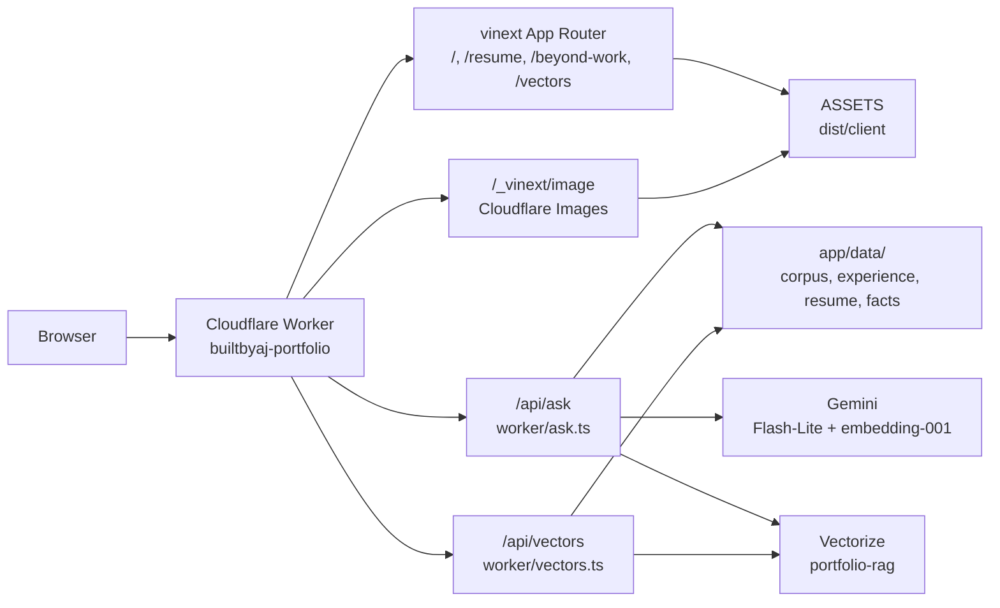
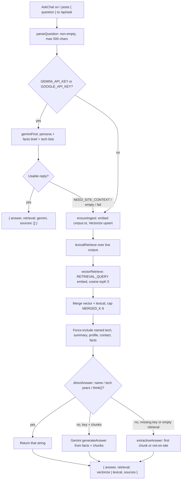

# Architecture

AJ Adversalo portfolio at [portfolio.ajhub.ca](https://portfolio.ajhub.ca). One vinext app in `f/` (Vite + Next App Router APIs) on Node `>=22.13`, deployed as a Cloudflare Worker. Pages (`/`, `/resume`, `/beyond-work`) and `/api/ask` share that Worker.

## Architecture

Notion images: [architecture.png](./diagrams/architecture.png) · [ask-workflow.png](./diagrams/ask-workflow.png)



## Ask workflow

Home hero `AskChat` (`app/components/ask-chat.tsx`) posts to same-origin `ASK_API_PATH` (`/api/ask`). The Worker intercepts that path in `worker/index.ts` before vinext pages. `worker/ask.ts` handles HTTP; `worker/rag.ts` does ingest, retrieve, and generate. Chunks come from `app/data/corpus.ts`, rebuilt for the current calendar month so year counts are not frozen at deploy.



### 1. Browser

Focus or submit on the hero field opens the chat dialog. Sample prompts, the hero field, and the composer all call `send(question)`.

`send` trims the text, stamps a turn id (`turn.current`), appends the user message, and `POST`s `{ question }` as JSON. If the visitor hits Clear while a request is in flight, the turn id increments and that reply is ignored. Escape, backdrop click, and the close button dismiss the dialog; Clear resets messages, draft, and pending.

The UI does not send chat history. Each question is a fresh retrieve-and-answer.

### 2. HTTP

`GET /api/ask` returns status only: chunk count, whether Vectorize and the Gemini key are bound, and the embedding / generation model names.

`POST /api/ask` requires JSON `{ question }`. `parseQuestion` rejects empty bodies and questions longer than 500 characters (`400`). Other methods return `405`. `ask()` failures return `500`. A successful body is `{ answer, retrieval }` where `retrieval` is `"gemini"`, `"vectorize"`, or `"lexical"`. Sources stay on the Worker result; the HTTP handler does not send them to the browser.

### 3. Gemini-first

When `GEMINI_API_KEY` or `GOOGLE_API_KEY` is bound, every message goes to Gemini `gemini-3.5-flash-lite` before any corpus search (`geminiFirst`).

The system prompt is `ajPersona()`: speak as AJ Adversalo in first person, Vancouver full-stack developer, not an assistant or model. Small talk and greetings are allowed. The user payload is `factsPassage()` (live tenure and counts), `techInventoryPassage()`, `undatedTechPassage()`, then the message.

Gemini is told to answer years, counts, employers, side projects, and named-tech tenure from that brief, and to reply with exactly `NEED_SITE_CONTEXT` when it needs project write-ups, how a product works, or how this chat retrieves answers.

`geminiNeedsSite` treats empty text, `NEED_SITE_CONTEXT`, and “I do not have that on this site yet” as a miss. A usable reply returns immediately with `retrieval: "gemini"` and no sources. A thrown Gemini error logs and falls through to retrieval. With no key, this pass is skipped.

### 4. Ingest

Retrieval calls `ensureIngest`. Once per Worker isolate per calendar month it embeds every live corpus chunk with Gemini `gemini-embedding-001` (`RETRIEVAL_DOCUMENT`, 768-d, L2-normalized, batches of 16) and `VECTORIZE.upsert`s them into index `portfolio-rag` (cosine). Metadata stores title, url, and source only; passage text is always read from the live corpus, not from Vectorize. Retired tech chunk ids are deleted when `deleteByIds` exists.

Ingest needs both the Gemini key and the `VECTORIZE` binding. Production index updates after `npm run deploy:worker` from `f/`, then the next ask that runs ingest.

### 5. Retrieve

Lexical search always runs on the live corpus (`lexicalRetrieve`, `topK` 5). Query tokens skip stopwords. Hits in chunk text score 1 or 2; generic tokens such as “years” and “projects” score 0.25; title hits add 2. Named-tech chunk ids from `techChunkIdsForQuestion` add 8, as do `summary` / `profile` / `contact` when the question looks like a summary, name, or contact ask.

Vector search (`vectorRetrieve`) embeds the question as `RETRIEVAL_QUERY`, queries Vectorize `topK` 5, and maps matches back to live corpus text. An empty first query waits 1.5s and retries (index lag after ingest). Missing key or binding returns `null` and leaves retrieval as `"lexical"`. Any Vectorize error reverts to lexical-only and records `retrievalError`. Vector hits present: merge vector-first then lexical, cap at `MERGED_K` 8, label `"vectorize"` even if some hits are lexical.

### 6. Grounding

Before generation, `withGrounding` force-includes chunks the question named but retrieval missed: tech ids, plus `summary`, `profile`, `contact`, and `facts` when those question detectors fire.

Then:

- Drop `tech-undated` when the question already named a dated technology, so “not stated” rows do not drown the years answer.
- Drop `site-rag` unless the visitor asked how the chat / RAG / Vectorize works.

Cap again at 8 chunks.

### 7. Generate

`generateAnswer` tries exact helpers first (`directAnswer`):

- Name-only questions → `My name is AJ Adversalo.`
- Named-tech years / projects / catalog → `lookupTechAnswer` in `tech-index.ts`
- Developer years, years in tech, side-project counts → `think()` in `facts.ts`

Those helpers do the arithmetic at request time from résumé spans and `beyondProjects`.

If there is no exact string, Gemini is called again with the persona, the facts brief, and numbered retrieved chunks. Instructions: first person, only from context, years questions return a year count only, project questions list matching projects, missing answers say so and point to a related fact. `maxOutputTokens` 700, thinking level `minimal`.

If the key is missing, retrieval is empty, Gemini throws, or Gemini returns empty text, `extractiveAnswer` returns the exact helper, else the top chunk text, else a first-person “not on this site yet” line pointing at Centra, GenXys, side projects, or how the chat retrieves answers.

### 8. UI after the reply

The dialog appends the assistant message. `COPY.askDisclaimer` (cosine nearest-neighbor wording) shows on assistant rows unless `retrieval === "gemini"`. HTTP or network failure shows `COPY.askUnavailable`. Pending copy is `COPY.askPending` (“Retrieving…”).

### Related: `/api/vectors`

`GET /api/vectors` runs the same ingest, then `describe` plus batched `getByIds` so `/vectors` can badge in-index vs corpus-only chunks and known stale ids. It is unlisted and `noindex`. The static Pages export has neither `/api/ask` nor `/api/vectors`.

## Routes

| Path | Source | Purpose |
| --- | --- | --- |
| `/` | `app/page.tsx` | Hero ask panel, toolkit, work |
| `/beyond-work` | `app/beyond-work/page.tsx` | Side Projects |
| `/resume` | `app/resume/page.tsx` | Printable résumé |
| `/vectors` | `app/vectors/page.tsx` | Unlisted Vectorize inspector (no nav link, `noindex`) |
| `/api/ask` | `worker/ask.ts` | RAG retrieve-and-answer over the site corpus |
| `/api/vectors` | `worker/vectors.ts` | Corpus + Vectorize `describe` / `getByIds` dump |

## Source layout

| Path | Role |
| --- | --- |
| `app/constants.ts` | Identity, URLs, routes, section ids, theme keys, UI copy |
| `app/data/` | Experience chapters, toolbox groups, side projects, résumé content, skill icons, RAG corpus |
| `worker/` | Cloudflare Worker entry, image optimization, `/api/ask` RAG |
| `app/components/` | Shared UI. See [components.md](./components.md) |
| `app/styles/` | CSS split by surface. See [styles.md](./styles.md) |
| `app/globals.css` | Tailwind plus style imports |
| `public/images/` | Site images. See [images.md](./images.md) |
| `public/favicon.*` | Lime AJ square tab icons at site root (relative hrefs, cache-busted) |

## Theme

`html[data-theme]` is `light` or `dark`. Default is light. `localStorage` key `theme`. The layout FOUC script and `ThemeToggle` must stay in sync.

Do not put favicon paths on the Next `Metadata` export. `metadataBase` would absolutize them to production URLs and 404 locally.

## Ask panel setup

Index and secrets (from `f/`):

```bash
npx wrangler vectorize create portfolio-rag --dimensions=768 --metric=cosine
cp .dev.vars.example .dev.vars
# GEMINI_API_KEY from https://aistudio.google.com/apikey
npx wrangler secret put GEMINI_API_KEY
npm run deploy:worker
```

The index already exists on this Cloudflare account; `wrangler vectorize create` then fails with `vectorize.index.duplicate_name`. Skip create and deploy. Local key lives in gitignored `.dev.vars`. Production key is a Worker secret on `builtbyaj-portfolio`. If Vectorize or the key is missing, retrieval uses lexical search over the same corpus chunks.

## Tests

`npm test` runs corpus/lexical tests (`tests/ask.test.ts`), then builds Worker + Pages artifacts and runs `tests/cloudflare.test.mjs` against `/`, `/resume`, `/beyond-work`, `/vectors`, `/api/ask`, and `/api/vectors`. The Pages export writes HTML routes into `out/`. `/api/ask` and `/api/vectors` exist on the Worker deploy, not on the static Pages export.
